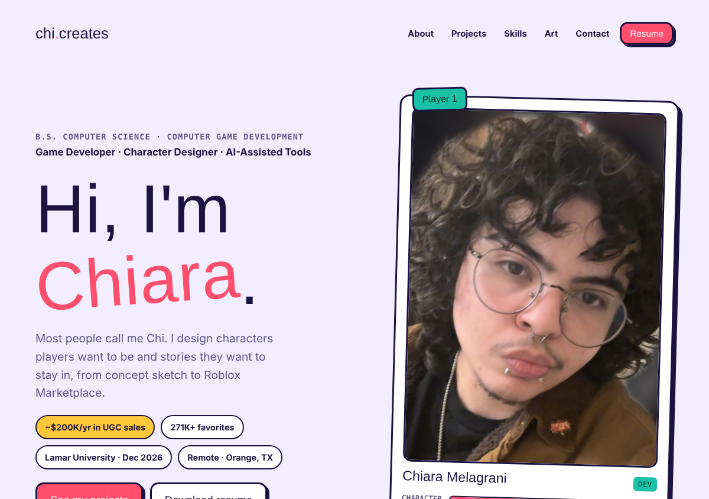

# Chiara Melagrani · Developer Portfolio

Professional portfolio for **Chiara (Chi) Melagrani**, B.S. Computer Science (Computer Game Development), Lamar University, December 2026. Built for COSC 4272 Senior Seminar and for my job search.

**Live site:** https://vampirefanged.github.io/github-portfolio/



## What's here

| Item | Where |
| --- | --- |
| Portfolio website (GitHub Pages) | [`index.html`](index.html) |
| Resume (PDF) | [`assets/resume.pdf`](assets/resume.pdf) |
| AI assistant project: **OC Forge** | [`oc-builder/`](oc-builder/) |
| AI project documentation | [`oc-builder/README.md`](oc-builder/README.md) |
| Course project: Procedural Maze Generator (Unity, C#) | [`maze-generator/`](maze-generator/) |
| Course project: Ghastly Midnights (C++, Direct3D) | [`ghastly-midnights/`](ghastly-midnights/) |
| AI prompt log | [`docs/ai-prompt-log.md`](docs/ai-prompt-log.md) |
| Job search analysis | [`docs/job-search-analysis.md`](docs/job-search-analysis.md) |
| Skills gap analysis | [`docs/skills-gap-analysis.md`](docs/skills-gap-analysis.md) |
| Screenshots | [`assets/screenshots/`](assets/screenshots/) |
| Examples | [`oc-builder/examples/`](oc-builder/examples/) |

## Website sections

- **Home:** photo, name, and professional title
- **About:** education, interests, career goals, and graduation date
- **Resume:** embedded online resume plus a downloadable PDF
- **Projects:** OC Forge (AI assistant), two course projects (Procedural Maze Generator in Unity, Ghastly Midnights in C++), and my Roblox dynamic heads business
- **Skills:** programming, systems, databases, cloud, AI tools, and creative skills
- **Art gallery:** original characters and commissions with a click-to-enlarge viewer
- **Contact:** email, LinkedIn, GitHub, and Roblox

## Folder structure

```
github-portfolio/
├── index.html                 # Portfolio home page
├── css/style.css              # Site styles
├── js/main.js                 # Gallery viewer and copy-email button
├── assets/
│   ├── resume.pdf
│   ├── photo.jpg
│   ├── art/                   # Character art and commissions
│   ├── heads/                 # Roblox dynamic head thumbnails
│   └── screenshots/           # Project screenshots
├── maze-generator/            # Course project: Unity maze (C# scripts, screenshots, demo)
├── ghastly-midnights/         # Course project: C++ ghost shooter (screenshots, demo)
├── oc-builder/                # AI assistant project (OC Forge)
│   ├── index.html
│   ├── css/style.css
│   ├── js/                    # app, prompt, providers, schema, demo, export
│   ├── tests/                 # Node unit tests
│   ├── package.json
│   └── README.md
└── docs/
    ├── ai-prompt-log.md
    ├── job-search-analysis.md / .pdf
    ├── skills-gap-analysis.md / .pdf
    └── resume-source.html     # Source used to build resume.pdf
```

## Technologies

HTML5, CSS3, and vanilla JavaScript, with no build step, so the site loads fast and deploys directly with GitHub Pages. The AI project uses the Google Gemini, OpenAI, and Anthropic Claude APIs and is tested with the Node.js built-in test runner.

## Run locally

```bash
git clone https://github.com/vampirefanged/github-portfolio.git
cd github-portfolio
python -m http.server 8000
# open http://localhost:8000
```

Run the AI project's tests:

```bash
cd oc-builder
npm test
```

## Quality checklist

- [x] Mobile-friendly layout (tested at 390 px wide)
- [x] Working navigation and Resume button
- [x] Downloadable one-page resume PDF
- [x] Images have alt text; gallery works with the keyboard
- [x] Respects reduced-motion settings
- [x] No build step; static files only

## AI-assisted development

I used Claude as a coding and writing assistant for this project. Every prompt, what the AI produced, and what I reviewed or changed is recorded in the [AI prompt log](docs/ai-prompt-log.md).

## Contact

- Email: chiara.melagrani@live.com
- LinkedIn: https://www.linkedin.com/in/chiara-melagrani-6a765b375/
- GitHub: https://github.com/vampirefanged

## License

Code is released under the [MIT License](LICENSE). Artwork in `assets/art/` and `assets/heads/` is © Chiara Melagrani and may not be reused without permission.
