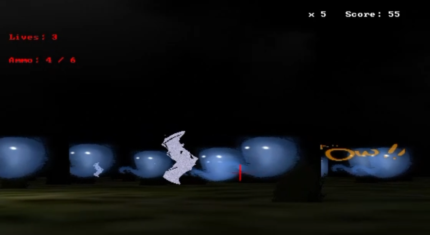
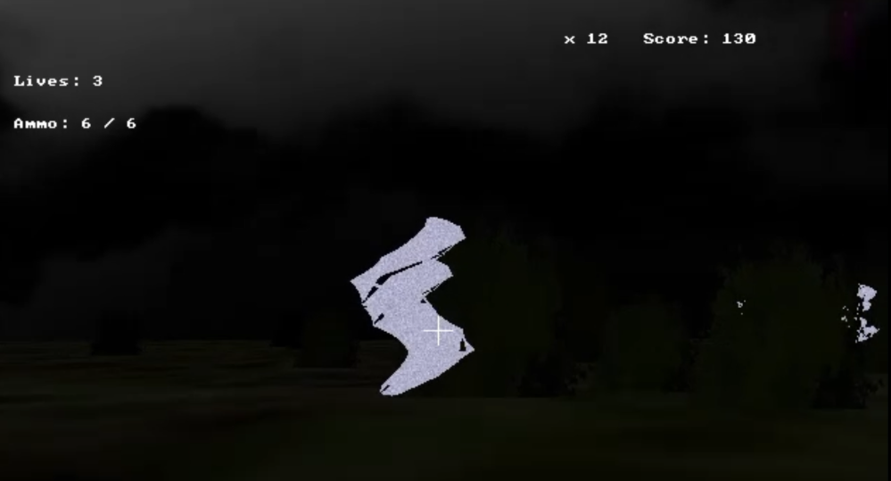
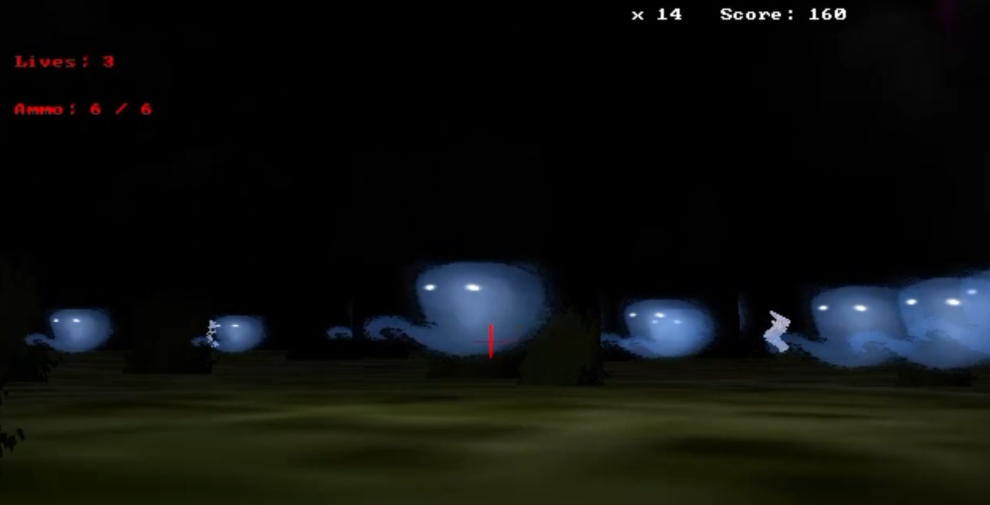
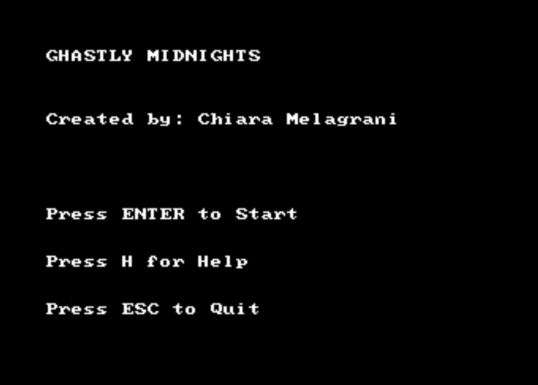
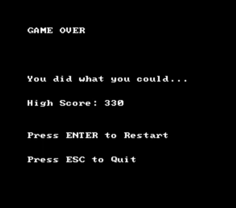

# Ghastly Midnights

**Type:** Course semester project, Lamar University · **Solo project**
**Language:** C++ · **Graphics:** Direct3D 9 · **IDE:** Visual Studio 2022

An arcade-style 3D survival shooter set in a dark graveyard. Ghosts drift in and randomly sprint at the player, who has three lives to rack up the highest score possible.

**Demo video:** [ghastly-demo.mp4](ghastly-demo.mp4)

## Gameplay

- **Endless ghost fight:** each ghost defeated is worth **+10 points**.
- **Rising difficulty:** ghosts get faster after every 10 kills.
- **Collectable souls:** scattered around the map for **+5 points** each.
- **Three lives:** ghosts randomly sprint at you, so you might turn around and get hit.
- **Limited ammo:** shown on the HUD with lives, kills, and score.
- **High score:** saved between runs.
- **A surprise:** a small, random jump scare.

### Controls

| Key | Action |
| --- | --- |
| Enter | Start or restart the game |
| H | Toggle the help page (all key bindings and the goal) |
| Esc | Quit |

## What I built

I created everything in the game myself except the background music, which a friend made and shared as free to use.

| Part | Tool |
| --- | --- |
| Game code | C++ with Direct3D 9, Visual Studio 2022 |
| Textures and art (ghosts, souls, graves, trees, sky) | Clip Studio Paint |
| Sound effects | Audacity |

I started from a basic shooter I wrote in an early class and expanded it into a fuller game: I added the scoring system, collectable souls, lives and ammo, difficulty that scales with your kills, a saved high score, title, help, and game-over screens, and an arcade-style HUD.

## Screenshots

| | |
| --- | --- |
|  |  |
|  |  |
|  | |

## Running it

The game is a Windows executable built for the course. Ask me for a copy of the build, or watch the [demo video](ghastly-demo.mp4).
