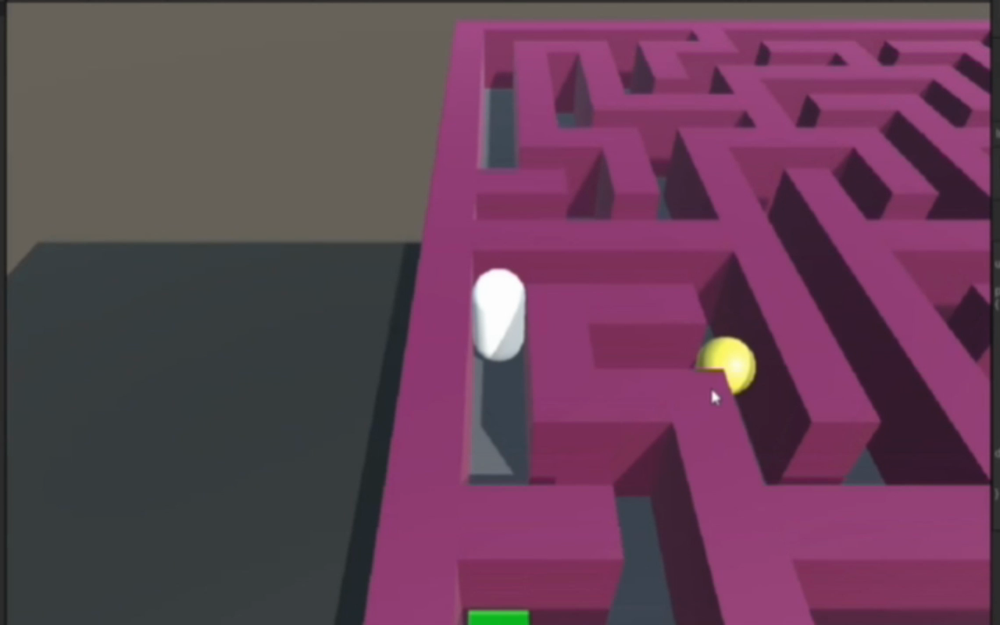
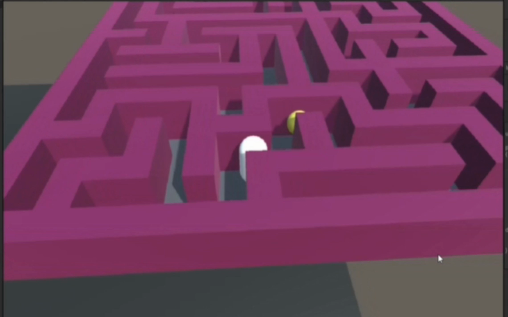
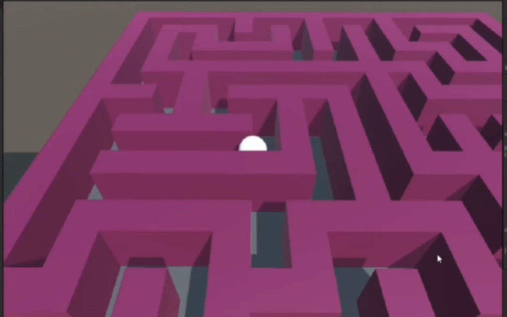

# Procedural Maze Generator (Unity)

**Course:** CPSC 4370 Artificial Intelligence, Lamar University, Fall 2025
**Team:** Chiara Melagrani, Issac Gros, Kody Braun (Group 1)
**Engine:** Unity 6 (6000.0.63f1) · **Language:** C#

A 3D maze game built in Unity. Every time the game starts, it generates a brand-new 21×21 maze that is always solvable. The player controls a character through the maze, and an AI agent uses A* pathfinding to walk the shortest route to the exit as a guide.

**Demo video:** [maze-demo.mp4](maze-demo.mp4)

## Features

- **Procedural generation:** a randomized depth-first search (DFS) carves paths through a grid of walls, so every layout is different but always has a path from start to exit.
- **A* pathfinding agent:** a yellow sphere computes the shortest path from the entrance to the exit with A* and the Manhattan-distance heuristic, then walks it to guide the player.
- **Player controls:** a third-person capsule character moves with WASD or the arrow keys.
- **Follow camera:** an overhead-and-behind camera tracks the player.
- **Start and goal:** the entrance is a green tile and the exit is a red tile.
- **Built at runtime:** the scene sets up its own lighting, ground, walls, player, camera, and agent when it loads, so no manual scene setup is needed.

## Technologies

| Area | Used |
| --- | --- |
| Engine | Unity 6 (6000.0.63f1) |
| Language | C# |
| AI algorithms | Randomized depth-first search (maze generation), A* search (pathfinding) |
| Tools | Unity Hub, Visual Studio |

## How it works

| Script | Responsibility |
| --- | --- |
| [`MazeGameManager.cs`](Scripts/MazeGameManager.cs) | Creates the scene at load time, generates the maze with randomized DFS, builds the wall and floor objects, spawns the player, camera, and agent, and runs A* to find the path |
| [`ThirdPersonController.cs`](Scripts/ThirdPersonController.cs) | WASD / arrow key movement for the player capsule |
| [`CameraFollow.cs`](Scripts/CameraFollow.cs) | Keeps the camera positioned behind and above the player |
| [`MazeAgentMover.cs`](Scripts/MazeAgentMover.cs) | Moves the AI agent along the A* path, waypoint by waypoint |

**Maze generation (DFS).** The grid starts as solid walls. Starting from one cell, the algorithm uses a stack to visit a random unvisited neighbor two cells away, removes the wall between them, and backtracks when it hits a dead end. Because DFS visits every cell, the result is a "perfect" maze: every cell is reachable, so the exit is always reachable too.

**Pathfinding (A*).** A* explores cells in order of `f = g + h`, where `g` is the distance travelled so far and `h` is the Manhattan distance to the exit. In a grid with no diagonal moves, Manhattan distance never overestimates, so A* is guaranteed to find the shortest path.

## Screenshots

| | |
| --- | --- |
|  |  |
|  | |

## Running it

The scripts in this folder are the project's source code. To run the full project:

1. Open **Unity Hub → Add** and select the Unity project folder (the one containing `Assets`).
2. Open it with Unity 6 (6000.0.63f1 or newer).
3. Press **Play**. A new maze is generated each time.

## Future improvements

From our project report: a first-person camera option, collectable items, interactable doors, jump scares, multiple floors or levels, visual effects, and a score system.
